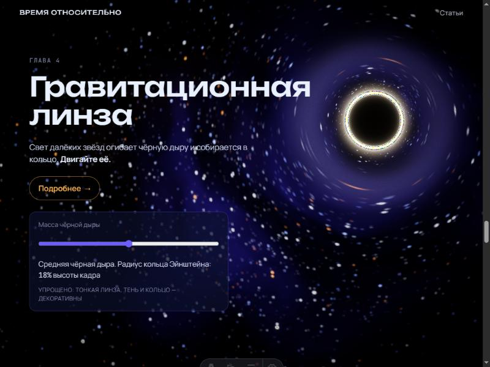

# Время относительно

Кинематографичный 3D-сайт о теории относительности Эйнштейна. Главная страница листается как фильм: одна непрерывная сцена, камера летит сквозь космос по прокрутке, главы сменяют друг друга, в каждой есть интерактив. К каждому явлению есть статья с историей открытия, формулами с подстановкой реальных чисел, живым интерактивом и источниками.

Пет-проект для портфолио. Сайт: `https://gargantua.space` (домен в честь чёрной дыры из «Интерстеллара»).



## Что внутри

**История (главная)**
0. Интро: звёздная пыль, купол туманностей, заголовок.
1. Световые часы: ползунок скорости до 0,99c, летящие часы тикают реже, лоренц-фактор и счётчики тиков.
2. Парадокс близнецов: выбираешь скорость и длительность, отправляешь близнеца, счётчики лет у каждого.
3. Гравитация гнёт пространство: сетка пространства-времени, клик кладёт звезду или чёрную дыру, планеты катятся по изгибу.
4. Гравитационная линза: чёрная дыра как пост-эффект, звёзды и туманности вытягиваются в кольцо Эйнштейна, следует за курсором или пальцем.
5. GPS: спутники вокруг Земли, тумблер релятивистской поправки, без неё точка «вы» на карте уплывает со скоростью 11,5 км в сутки.
6. Финал: дорога пройденных глав, ссылки на статьи.

Между главами камера летит сквозь поток пыли, цвет которого переходит от цвета одной главы к цвету следующей.

**Статьи** (`/articles`): вводная «СТО и ОТО: в чём разница», замедление времени, парадокс близнецов, искривление пространства-времени, гравитационная линза, GPS и относительность. Структура каждой: суть, история, формулы с расшифровкой букв и подстановкой чисел, интерактив, факты, источники.

## Стек

| Слой | Технологии |
|---|---|
| Каркас | Astro 7, статическая сборка, MDX, коллекции контента |
| 3D | React Three Fiber, drei, @react-three/postprocessing, собственные GLSL-шейдеры |
| Скролл и анимация | GSAP + ScrollTrigger (мастер-таймлайн), Lenis + lenis/snap, Motion для интерфейса |
| Состояние | zustand (vanilla store, общий для островов Astro) |
| Формулы | KaTeX на сборке (remark-math + rehype-katex), живые числа через `\htmlClass`-слоты |
| OG-картинки | satori + sharp на сборке |
| Тесты | vitest для физики (`src/physics`, `tests`) |

## Как запустить

```bash
npm install
npm run dev        # http://localhost:4321
npm run build      # статическая сборка в dist/
npm run preview
npm test           # тесты физики
npm run check      # типы и Astro-диагностика
```

Полезные флаги в адресной строке для проверки режимов: `?reduce=1` (без полёта камеры, как при prefers-reduced-motion), `?nowebgl=1` (текстовая версия с кадрами-подложками), `?quality=low|medium|high`.

## Как это устроено

- **Три острова и один store.** Текст глав — обычный HTML Astro. Панели интерактивов — маленькие React-острова. Сцена — один остров с фиксированным канвасом. Связаны через zustand vanilla store, который острова Astro делят как общий модуль.
- **Камера.** Один GSAP-таймлайн со `scrub` на всю страницу. Камера идёт по кривой через якоря глав; в удержании живёт интерактив, snap к кадрам глав делает `lenis/snap`. Главы монтируются лениво за одну главу до входа в кадр и гаснут на середине перелёта, чтобы не просвечивать друг сквозь друга.
- **Постобработка.** DoF → гравитационная линза (отдельный проход) → bloom, зерно, виньетка, ACES. Линза рисуется как кастомный `Effect` postprocessing по модели тонкой линзы точечной массы.
- **Качество.** Уровни `high / medium / low` управляют DPR, частицами, октавами купола, сегментами сетки. Телефон стартует с `medium`, `PerformanceMonitor` понижает уровень при падении ниже 30 FPS.
- **Точность.** Все числа в статьях считаются функциями из `src/physics` и проверяются тестами: 1,75″ у края Солнца, 43″ в столетие для Меркурия, +45,7 / −7,2 / +38,4 мкс в сутки для GPS и так далее. Где визуализация упрощена, стоит пометка «упрощено»; факты без надёжного первоисточника помечены «требует проверки».

Подробный план и решения по ходу работы: [docs/PLAN.md](docs/PLAN.md). Скриншоты: [docs/screenshots](docs/screenshots).

## Структура

```
src/
  pages/           главная, статьи, оглавление, OG-картинки, 404
  layouts/         Base (SEO, шрифты), Article (колонка 70ch, оглавление сбоку)
  content/         статьи в MDX
  components/      story (секции глав), controls (панели глав), article (формулы, факты, интерактивы)
  scene/           всё внутри Canvas: камера, фон, купол, пыль, главы, пост-эффекты
  story/           список глав, store, контроллер скролла
  physics/         чистые функции СИ: lorentz, twins, lens, gravity, gps
  styles/          токены, глобальные стили, история, статьи
tests/             vitest для физики
public/fallback/   кадры-подложки для версии без WebGL
scripts/           обрезка кадров-подложек
```

## Деплой

Сборка полностью статическая: `npm run build` кладёт сайт в `dist/`. Подходит любой статический хостинг (Cloudflare Pages, Netlify, Vercel, GitHub Pages). Команда сборки `npm run build`, папка публикации `dist`. Домен задаётся в `astro.config.mjs` (`site`), от него зависят canonical, OG и sitemap.

## Автор

Сделано [OreSameXD](https://github.com/OreSameXD). Физика проверена по источникам, перечисленным в конце каждой статьи.
